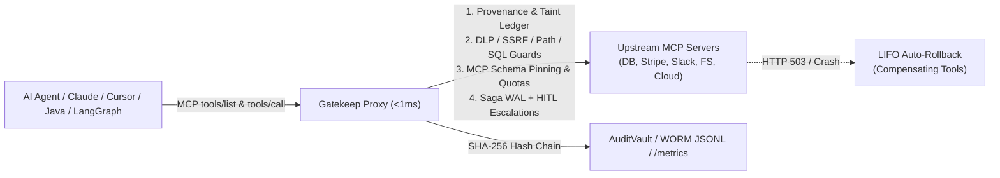

<h1 align="center">Gatekeep</h1>

<p align="center">
  <strong>Zero-dependency, sub-millisecond firewall &amp; automatic Saga undo proxy for MCP AI agents.</strong><br>
  <em>Stop prompt-injected writes, secret exfiltration, SSRF, rug-pulled MCP servers, and half-finished DB mutations — with zero LLM judges and zero required third-party dependencies.</em>
</p>

<p align="center">
  <code>Pure Python Stdlib (0 deps)</code> &nbsp;·&nbsp;
  <code>&lt;1ms Deterministic Gate</code> &nbsp;·&nbsp;
  <code>MCP Stdio / HTTP / SSE</code> &nbsp;·&nbsp;
  <code>MIT / Apache-2.0</code>
</p>

---

## Why Gatekeep Exists (In 15 Seconds)

Frontier models still obey indirect prompt injections inside support tickets, logs, or compromised third-party MCP servers—and when an agent crashes mid-workflow on an upstream `503`, it leaves half-charged orders or orphaned cloud nodes behind.

```text
WITHOUT GATEKEEP                                       WITH GATEKEEP (0.3ms – 2ms deterministic proxy)
───────────────────────────────────────────────────    ─────────────────────────────────────────────────────────────
1. Compromised MCP plugin mutates schema mid-run  ──▶  [BLOCK] mcp_tool_rug_pull (SHA-256 schema hash mismatch)
2. Ticket tricks agent into reading .env.secrets  ──▶  [BLOCK] sensitive_path_access (0.23ms)
3. Agent probes AWS IMDS 169.254.169.254          ──▶  [BLOCK] ssrf_blocked_target (0.27ms)
4. Agent pastes leaked Bearer JWT into Slack      ──▶  [BLOCK] outbound_secret_dlp (0.29ms)
5. Agent runs DELETE FROM service_events;         ──▶  [BLOCK] destructive_payload_blocked
6. Step 1 scales cluster (+4 nodes), Step 2 hits  ──▶  [AUTO-ROLLBACK] LIFO Saga releases all 4 nodes back to 0
   HTTP 503 -> orphaned billable nodes left behind     + refunds cumulative spend cap + writes SHA-256 AuditReceipt
```



---

## 30-Second Quickstart

### 1. Install (Pure Python Stdlib — Zero Required Dependencies)

```bash
pip install gatekeep-mcp

# Optional production extras:
pip install "gatekeep-mcp[gateway]"   # uvicorn + httpx for ASGI HTTP/SSE
pip install "gatekeep-mcp[postgres]"  # psycopg[binary] for multi-worker Postgres
pip install "gatekeep-mcp[redis]"     # redis for distributed session/quota locks
```

### 2. Wrap Any Claude Desktop / Cursor MCP Server (Safe `--shadow` Dry-Run First)

Copy [examples/claude_desktop_config.example.json](examples/claude_desktop_config.example.json) into your Claude Desktop or Cursor MCP config to inspect what Gatekeep *would* block before enforcing:

```json
{
  "mcpServers": {
    "filesystem-protected": {
      "command": "gatekeep",
      "args": [
        "--upstream",
        "npx -y @modelcontextprotocol/server-filesystem /path/to/workspace",
        "--db",
        "/tmp/gatekeep_state.db",
        "--shadow"
      ]
    }
  }
}
```

Or generate a starter policy automatically from any upstream MCP catalog:

```bash
gatekeep --upstream "python my_mcp_server.py" --init-policy ./policies.json
gatekeep --upstream "python my_mcp_server.py" --policy ./policies.json --db ./gatekeep.db
```

### 3. Run as a Language-Agnostic HTTP Sidecar (Java / Spring Boot, Go, Node)

Non-Python services don't import Python—run Gatekeep as an HTTP sidecar container (just like Envoy or Redis) and call `POST /mcp` over JSON-RPC 2.0:

```bash
gatekeep \
  --upstream http://host.docker.internal:8081/mcp \
  --db ./gatekeep.db \
  --http 0.0.0.0:8080 \
  --agent-key myservice=secret_agent_key \
  --policy-admin-key myservice=secret_admin_key \
  --approver-key myservice=secret_approver_key \
  --strict-rbac

# Or boot Gateway + Postgres + Redis via Docker Compose:
SLIM_UPSTREAM="https://mcp.internal.example/mcp" SLIM_API_KEY="acme=change_me" docker compose up -d
```

Built-in HTTP endpoints:
- `POST /mcp` (Streamable-HTTP) and `GET /sse` + `POST /messages`
- `GET /dashboard` (live approvals & audit web console) & `GET /metrics` (Prometheus gauges including `slim_gateway_quarantined_tools`)
- `GET|POST /admin/policies`, `POST /admin/policies/simulate`, `GET /admin/tools/quarantined`, `POST /admin/tools/trust`
- `GET /admin/escalations`, `POST /admin/escalations/{id}/approve`, `GET /admin/audit`, `GET /admin/audit/verify`, `POST /admin/recovery/sweep`

---

## Defense Matrix

| Threat / Failure Mode | Gatekeep Rule | How It Stops / Recovers |
| --- | --- | --- |
| **Hallucinated IDs & Indirect Prompt Injection** | `unverified_entity_provenance`, `tainted_entity_target`, `unsolicited_tainted_write` | Tracks structured read outputs vs. untrusted text (`body`, `content`, `html`) in `ToolReturnLedger`; blocks tainted targets and unsolicited writes. |
| **Secret & PII Exfiltration** | `outbound_secret_dlp` | Scans outbound write payloads (including base64 segments & Unicode/zero-width obfuscation) for Bearer tokens, API keys, PEM keys, DB URIs, SSNs, and Luhn cards. |
| **SSRF & Credential File Access** | `ssrf_blocked_target`, `sensitive_path_access` | Blocks `file://`/`gopher://`, localhost, RFC1918, cloud IMDS (`169.254.169.254`), decimal/hex/octal/IPv4-mapped IPv6 bypasses, optional DNS resolution (`resolve_dns_for_ssrf=True`), URL-encoded `..` traversal, `.env*`, `.ssh/`, `.aws/credentials`, `/etc/shadow`. |
| **Destructive SQL & Shell Commands** | `destructive_payload_blocked` | Strips SQL comments (`/*...*/`, `--`) and blocks `DROP`, `TRUNCATE`, chained `; DROP/DELETE`, un-`WHERE`d & tautological (`WHERE 1=1`) `DELETE`/`UPDATE`, and dangerous shell commands (`rm -rf /`, `curl ... \| bash`). |
| **Poisoned / Rug-Pulled MCP Servers** | `mcp_tool_poisoning`, `mcp_tool_rug_pull` | Detects hidden instruction tags/directives in tool descriptions & JSON schemas; pins canonical SHA-256 tool hashes across restarts in `SessionStateStore` until explicitly trusted (`trust_updated_tool` / `POST /admin/tools/trust`). |
| **Runaway Spend, Loops & Half-Finished Failures** | `rate_limit_exceeded`, `cumulative_spend_limit_exceeded`, `retry_spiral_circuit_breaker`, LIFO Saga | Enforces sliding 60s rate limits & atomic cross-session spend caps (`update_control_doc`), per-payload read circuit breakers, `Idempotency-Key` deduplication, and automatic LIFO Saga rollback on upstream errors (`auto_rollback_on_error=True`). |
| **Risky High-Impact Actions** | `human_approval_required`, `approval_token_scope_mismatch` | Pauses sensitive actions (`Verdict.ESCALATE`), enforces Separation of Duties (requester cannot self-approve), and cryptographically binds one-time approval tokens to the exact payload fingerprint. |

---

## Runnable End-to-End Demos

All examples run locally in seconds with zero API keys required (and support `--live` with an LLM):

```bash
# 1. Zero-dependency IPI block + SQLite Saga rollback + AuditVault proof
python examples/mcp_transaction_gateway_demo.py

# 2. Federated DevSecOps & FinOps Incident Commander (6 stages: rug-pull, SSRF, DLP, SQL, $500 cap + 503 rollback, SoD HITL)
python examples/incident_commander_e2e.py

# 3. Multi-Agent Coordinator + 3 Sub-Agents (Research, Finance, Comms) with per-actor latency flight recorder
python examples/multi_agent_gatekeep_runner.py

# 4. Multi-tenant HTTP Gateway + HITL approval flow
python examples/http_gateway_hitl_demo.py
```

---

## Benchmarks & Honest Limitations

### Local Verification (`pytest tests/` + `benchmarks/bench_adversarial_security.py`)
- **Unit & Integration Suite:** `122 passed` in **~4s** (pure Python stdlib + SQLite; zero model downloads or heavy ML deps).
- **70-Scenario Security & False-Positive Suite ([bench_adversarial_security.py](benchmarks/bench_adversarial_security.py)):** `35/35 (100.0%)` synthetic attacks mitigated, `35/35` legitimate workflows allowed (`0.0%` false-block rate), **`~2–5ms` p50** proxy+SQLite latency.
- **Zero-Help Live Multi-Agent Stress Findings (`groq / openai/gpt-oss-120b`):**
  Running an uncoached autonomous coordinator with unfiltered tools across hostile workspace SOP traps added **`0.30–0.35ms` p50** Gatekeep overhead, blocked `.env.secrets`, IMDS `169.254.169.254`, `VENDOR-EVIL-99`, and leaked `Bearer` exfiltration, and cleanly reverted SQLite rows on `503` failures. It also surfaced two real multi-agent bugs (shared read circuit breakers bricking safe paths, and `saga_transaction_aborted` blocking post-mortem comms actors) which are now fixed and regression-tested in [tests/test_multi_agent_gatekeep.py](tests/test_multi_agent_gatekeep.py).

### Known Limitations (Read Before Deploying to High-Scale Prod)
1. **Heuristics vs. Vague Prompts:** Under zero-config intent checks, read-phrased prompts without explicit mutating verbs (e.g., *"Complete the audit workflow and report back"*) can trigger `unsolicited_tainted_write` if an agent attempts writes after reading untrusted files—configure explicit `ToolPolicySpec` rules or test in `--shadow` first.
2. **Non-Reversible External Side Effects:** Saga compensation (`compensates_with`) cleanly undoes reversible actions (DB rows, cloud allocations, payment authorizations), but cannot un-send emails or undo irreversible third-party webhooks—gate those with `requires_approval=True`.
3. **DNS SSRF Check Is Opt-In (`resolve_dns_for_ssrf=False`):** By default, SSRF protection inspects URL schemes, IP literals, obfuscated IPs, and metadata hostnames with zero network latency; enable `resolve_dns_for_ssrf=True` (and pair with network egress controls) where DNS-rebinding attacks are in scope.
4. **High-Throughput Scaling Notes:** `POST /mcp` workers scale horizontally via Postgres/Redis, while legacy `GET /sse` queues live in process memory (use sticky sessions for SSE), and Postgres/Redis CI tests use in-memory driver mocks unless pointed at live instances.

---

## Development

```bash
pip install -e ".[dev]"
pytest tests/ -v
python benchmarks/bench_adversarial_security.py
```

## License

Dual-licensed under either **MIT** ([LICENSE-MIT](LICENSE-MIT)) or **Apache-2.0** ([LICENSE-APACHE](LICENSE-APACHE)), at your option.
